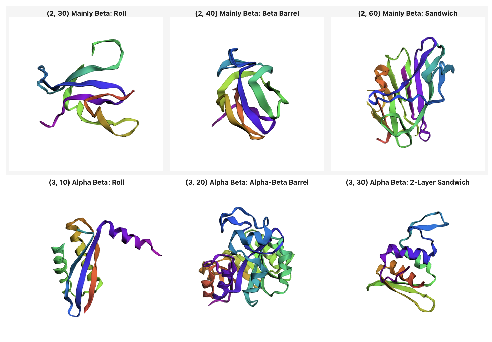
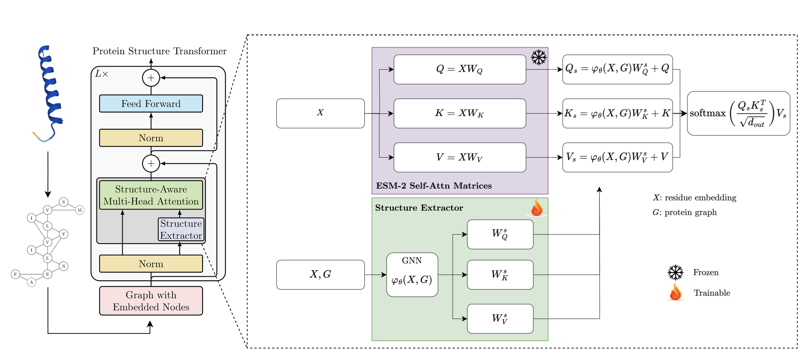
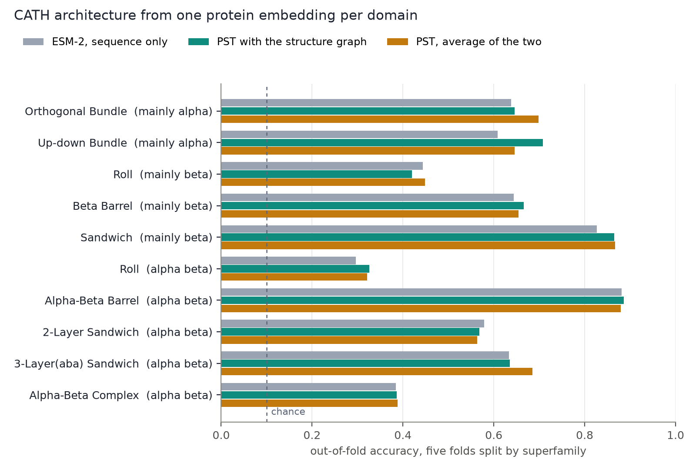

# Protein architecture classification with the Protein Structure Transformer

Predicting the CATH architecture of a protein domain from its sequence and 3D structure, using
embeddings from the Protein Structure Transformer (PST).



*One domain from six of the ten architectures, rendered with py3Dmol in the
[Kaggle notebook](https://www.kaggle.com/code/qmarva/wip-protein-structure-transformers).*

## The problem

[CATH](https://www.cathdb.info) classifies protein domains in four levels. **Class** reflects the
secondary structure content: mainly alpha, mainly beta, alpha-beta, or few secondary structures.
**Architecture** describes the overall shape the helices and strands form in space, such as a
bundle, a barrel or a sandwich, without regard to how they are connected. **Topology** (the fold)
adds the connectivity, and the **homologous superfamily** groups domains with evidence of a common
ancestor. A domain's classification is written as four numbers, for example 3.90.1170.50 for
domain 2w3sB01.

The task here is the second level: given a domain's sequence and coordinates, predict which of
ten architectures from classes 1 to 3 it belongs to. The classes are balanced:

| Label | CATH | Class | Architecture | Domains |
|---:|---|---|---|---:|
| 0 | 1.10 | Mainly Alpha | Orthogonal Bundle | 627 |
| 1 | 1.20 | Mainly Alpha | Up-down Bundle | 626 |
| 2 | 2.30 | Mainly Beta | Roll | 640 |
| 3 | 2.40 | Mainly Beta | Beta Barrel | 634 |
| 4 | 2.60 | Mainly Beta | Sandwich | 630 |
| 5 | 3.10 | Alpha Beta | Roll | 614 |
| 6 | 3.20 | Alpha Beta | Alpha-Beta Barrel | 613 |
| 7 | 3.30 | Alpha Beta | 2-Layer Sandwich | 627 |
| 8 | 3.40 | Alpha Beta | 3-Layer(aba) Sandwich | 628 |
| 9 | 3.90 | Alpha Beta | Alpha-Beta Complex | 634 |

The label ids are defined in [scripts/cath_labels.py](scripts/cath_labels.py).

## Data

The data set has 6,273 domains cut from 5,356 PDB entries. They come from 833 topologies and
3,568 homologous superfamilies. All are experimental structures with resolutions from 0.75 to
3.49 Å (median 2.0 Å), and the domains are 13 to 1,202 residues long (median 122).

It consists of two parts:

- `data/cath_data.csv`, one row per domain with the columns `cath_id`, `class`, `architecture`,
  `topology`, `superfamily`, `resolution_in_angstroms`, `pdb_id`, `sequences` and `cath_indices`
  (the domain's residue ranges). The `superfamily` column holds only the last of the four CATH
  numbers, so the code joins all four columns to get a superfamily id.
- `data/pdb/<cath_id>.pdb`, the coordinates of each domain, already cut to the domain boundaries.

The files are not part of this repository. The coordinates come from the
[Protein Data Bank](https://www.wwpdb.org), whose data are released under
[CC0 1.0](https://www.wwpdb.org/about/usage-policies), and the labels from
[CATH](https://www.cathdb.info), released under [CC BY 4.0](https://creativecommons.org/licenses/by/4.0/).
The CATH release the set was built from is not recorded. A comparable set can be assembled from
CATH's [download site](https://www.cathdb.info/download): `cath-domain-list.txt` gives the four
CATH numbers and the resolution of every domain, and CATH also distributes the coordinates of
each domain as a PDB file. The scripts only need the PDB files and the `cath_id`, `class`,
`architecture`, `topology` and `superfamily` columns.

## Approach



*The Protein Structure Transformer. Figure from Chen et al. (2024).*

[PST](https://arxiv.org/abs/2401.14819) (Chen et al., 2024) adds structure to the protein
language model ESM-2. A residue graph connects residues whose C-alpha atoms are within 8 Å, and a
small graph network, the structure extractor, computes a vector for every residue from its
neighbourhood in that graph. These vectors are added to the queries, keys and values of every
self-attention block. The authors trained the structure extractor on 542k AlphaFold structures
from SwissProt. In the `_so` models ("structure only") the ESM-2 weights stayed frozen during this
training, so the same model run without the graph is plain ESM-2.

I use PST as a frozen feature extractor. The PST code itself lives in the `PST` submodule, which
points to the authors' repository at commit `57d9dcd`; nothing in it is modified. This repository
adds the following.

**Embeddings.** [scripts/cath_dataset.py](scripts/cath_dataset.py) turns every PDB file into
PST's input: the sequence read from the C-alpha atoms as ESM tokens, and the 8 Å residue graph.
[scripts/extract_embeddings.py](scripts/extract_embeddings.py) runs `pst_t33_so` (ESM-2 650M
backbone, 1,280 dimensions) on each domain twice, with and without the graph, averages the two
per-residue outputs as PST's own extraction script does, and averages over residues to get one
vector per domain.

**MLP on the embeddings.** [models/mlp_model.py](models/mlp_model.py) is a three-layer MLP with
dropout. [scripts/train_mlp.py](scripts/train_mlp.py) evaluates it with five-fold
cross-validation in which a superfamily never appears in two folds. Domains of one superfamily
are related and often similar in sequence, so a random split would let the model match test
domains to their relatives in the training set; with the grouped split the score measures how
well it recognises an architecture in superfamilies it has not seen. Within each training fold,
10% of the superfamilies are held out to choose the checkpoint, so the test fold is used only
for the reported numbers.

**Graph network on residues.** Architecture is about how secondary structure elements are
packed, which suggests pooling residues step by step into larger units rather than averaging
them all at once. [models/hgnn_model.py](models/hgnn_model.py) implements this with Hierarchical
Graph Pooling with Structure Learning (HGP-SL, [Zhang et al., 2020](https://arxiv.org/abs/1911.05954)):
each pooling layer keeps a fraction of the nodes (half by default), those that their neighbours
describe least well, then learns new edges between the kept nodes with an attention score. The layers in
[models/hgp](models/hgp) are adapted from the [authors' code](https://github.com/cszhangzhen/HGP-SL).
The intended input is the residue graph with per-residue PST embeddings as node features. Only
the model exists so far; there is no data pipeline or training script for it.

## Results

The [Kaggle notebook](https://www.kaggle.com/code/qmarva/protein-architecture-classification-with-pst) runs the
pipeline at commit `c8f4107` on a T4: graphs and `pst_t33_so` embeddings for all 6,273 domains (43 minutes), then the
MLP cross-validated on three embeddings from that one pass. With the residue graph PST gives the structure-aware
embedding; without it, since the `_so` model kept the ESM-2 weights, it is plain ESM-2, a sequence-only embedding; the
third is their average, as in PST's own extraction script. All three use the same five folds, split by superfamily.
The ten classes are balanced, so chance is 10%.

| Embedding | Accuracy | Macro F1 |
|---|---|---|
| ESM-2, sequence only | 0.592 ± 0.037 | 0.585 ± 0.034 |
| PST with the structure graph | 0.608 ± 0.047 | 0.598 ± 0.043 |
| PST, average of the two | **0.613 ± 0.040** | **0.602 ± 0.037** |

Mean and standard deviation over the folds. The spread comes mostly from the folds themselves (accuracy from 0.55 to
0.69 for every embedding), so the comparison is fold by fold: the averaged embedding beats sequence alone in all five
folds, by 0.7 to 3.5 points (2.1 on average), and the structure-aware one in four of five (1.7 on average). The
structure helps, consistently but not by much.



The architectures differ far more than the embeddings do. The beta sandwich and the alpha-beta barrel are recognised
in more than 80% of cases. The alpha-beta roll (about 0.3), the alpha-beta complex (about 0.39) and the beta roll (about 0.44)
are the hardest; the alpha-beta complex is CATH's class for irregular arrangements, so it has no single shape to learn.
The largest gain from structure is on the up-down bundle (0.61 with sequence alone, 0.71 with the graph).

One mean vector per domain says what the residues look like on average, not how the helices and strands are arranged,
which is what an architecture is. That is the case for the graph network with hierarchical pooling described above,
which is not trained yet.

Not done:

- A dataset of residue graphs with per-residue PST embeddings, and training of the HGP-SL graph network on it.
- Other ways to pool the residues (attention pooling, concatenating layers with `--aggr`), and the larger PST models.

## How to run

Set up the environment (Python 3.11):

```bash
git clone https://github.com/xmarva/protein-structure-transformer.git
cd protein-structure-transformer
git submodule update --init        # fetches PST into PST/

python3.11 -m venv .venv
source .venv/bin/activate
pip install -r requirements.txt
# torch_scatter and torch_cluster must match your torch and CUDA build, for example on CPU:
pip install torch_scatter==2.1.2 torch_cluster==1.6.3 -f https://data.pyg.org/whl/torch-2.5.0+cpu.html
```

The scripts import `pst` straight from the submodule, so PST does not need to be installed.
Put the data in `data/` as described above and run from the repository root:

```bash
# one vector per domain; downloads the PST weights to .cache/pst/ on first use
python -m scripts.extract_embeddings --datadir data --cath data/cath_data.csv --model pst_t33_so --include-seq

# five-fold cross-validation grouped by superfamily; writes logs/mlp_cv/metrics.json and predictions.csv
python -m scripts.train_mlp data/embeddings/pst_t33_so.pt
```

For the full set, `pst_t33_so` is practical only on a GPU. For a quick test on CPU, use `--model pst_t6_so` (320
dimensions) on a few PDB files.

The graph network can be used on any PyG batch of graphs; the docstring of
[models/hgnn_model.py](models/hgnn_model.py) has a minimal example.

## Repository layout

```
.
├── PST/                        PST submodule (BorgwardtLab/PST)
├── imgs/                       figures for this README
├── models/
│   ├── mlp_model.py            MLPClassifier: MLP on one embedding per domain
│   ├── hgnn_model.py           HierarchicalGNN: GCN layers with HGP-SL pooling
│   └── hgp/                    HGP-SL layers: pooling, GCN, sparsemax
├── scripts/
│   ├── cath_labels.py          the ten architectures and their label ids
│   ├── cath_dataset.py         PDB files to PST input graphs with CATH labels
│   ├── extract_embeddings.py   PST embedding of every domain
│   └── train_mlp.py            MLP cross-validation grouped by superfamily
├── requirements.txt
└── ruff.toml
```

## Notes

- The residue graph uses PyTorch Geometric's `radius_graph` with its default limit of 32
  neighbours per residue, as in PST's example code.
- Some PDB files list alternate locations of a residue. The dataset keeps the first C-alpha atom
  of each residue; the earlier version used on Kaggle kept all of them, which added duplicate
  residues to 212 of the 6,273 domains.
- Without neighbour sampling, HGP-SL learns edges between all pairs of kept nodes in a graph, so
  its memory grows with the square of the domain length.
- PST is released under the BSD 3-Clause license (see `PST/LICENSE`). Its pretrained weights are
  downloaded from the authors' server on first use.

## References

- D. Chen, P. Hartout, P. Pellizzoni, C. Oliver, K. Borgwardt. Endowing Protein Language Models
  with Structural Knowledge. arXiv:2401.14819, 2024. Code: https://github.com/BorgwardtLab/PST
- Z. Zhang, J. Bu, M. Ester, J. Zhang, C. Yao, Z. Yu, C. Wang. Hierarchical Graph Pooling with
  Structure Learning. arXiv:1911.05954, 2019. Code: https://github.com/cszhangzhen/HGP-SL
- I. Sillitoe et al. CATH: increased structural coverage of functional space. Nucleic Acids
  Research 49(D1), 2021.

## License

The code in this repository is released under the [MIT License](LICENSE), with two exceptions. The HGP-SL layers in
`models/hgp/` are adapted from the [authors' code](https://github.com/cszhangzhen/HGP-SL), which is published without a
license, so the MIT License does not extend to them. `imgs/pst-architecture.png` is a figure from the PST paper. The
`PST` submodule is BSD 3-Clause.
